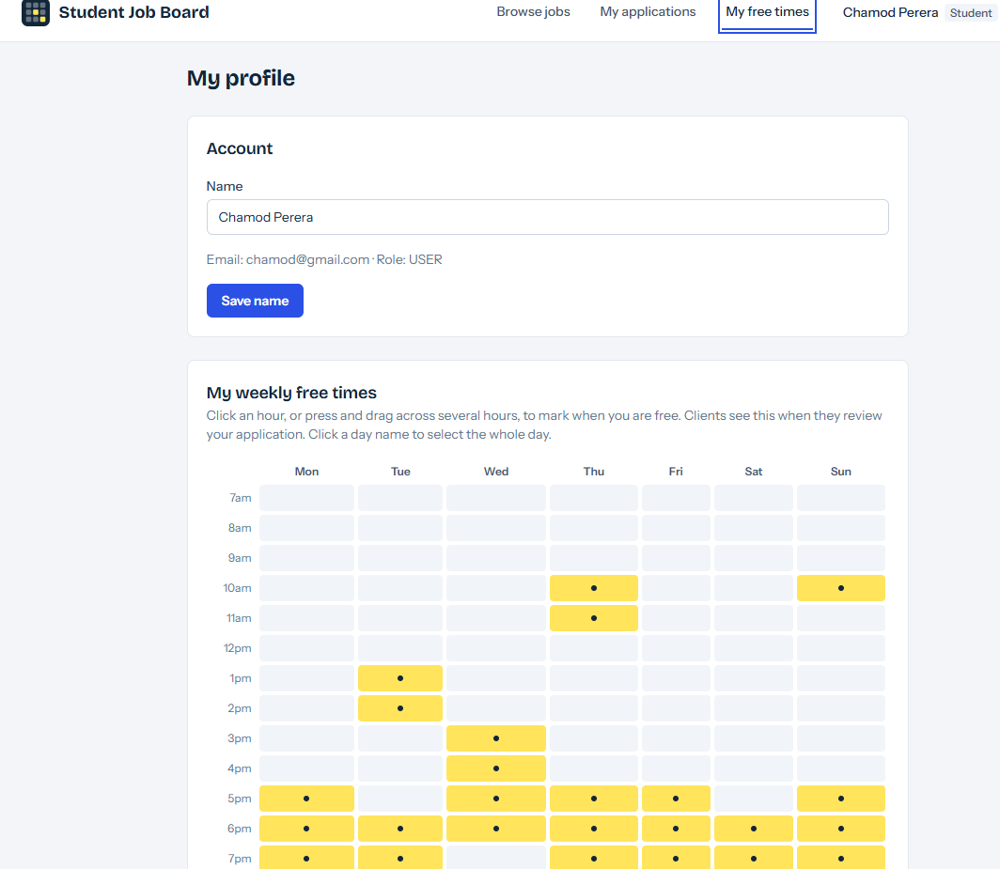
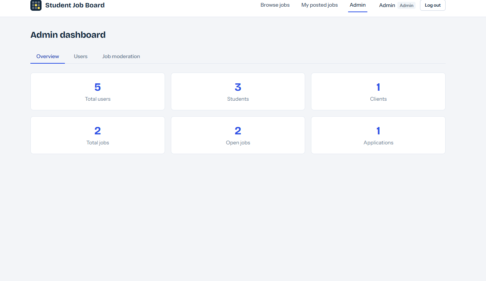

# Student Freelance Job Board - Frontend

> Paid work that fits around your lectures. Students mark the hours they are free, and clients see exactly when they can start.

Student Freelance Job Board is a web application where **clients** post small paid jobs and **students** apply for them. Every student keeps a weekly free-time timetable that the client sees together with the application. Students can write their cover letter with AI and get an email when they are accepted or rejected.

This repository is the **React + TypeScript frontend**. The REST API is in the [backend repository](https://github.com/yasadidias/student-freelance-job-board).

## Live demo

| | Link |
|---|---|
| Website (frontend) | https://student-freelance-job-board-web.vercel.app |
| API (backend) | https://student-freelance-job-board.vercel.app |
| Frontend repository | https://github.com/yasadidias/student-freelance-job-board-web |
| Backend repository | https://github.com/yasadidias/student-freelance-job-board |

## About

- **Name:** Yasadi Dias
- **Module / assignment:** ITS2020 Rapid Application Development (RAD), final coursework (individual)

## Tech stack

| Area | Technologies |
|---|---|
| Frontend | React 19, TypeScript, Vite |
| Styling | TailwindCSS v4 (responsive layout) |
| State management | Redux Toolkit (auth, jobs and applications slices) with typed hooks |
| Routing | React Router with role-based protected routes |
| HTTP | Axios with an interceptor that refreshes the access token automatically |
| Deployment | Vercel |

## Features

**Everyone**
- Job board with search, category filter and pagination
- Job details page
- Register and log in as a **Student** or a **Client**; the session is kept with JWT access and refresh tokens
- Role-based protected routes and a responsive TailwindCSS design

**Students**
- Apply to a job with a cover letter and **write the cover letter with AI**
- My applications: see the status (pending, accepted, rejected) and withdraw a pending application
- **Weekly free-time timetable** (Monday to Sunday, 7am to 10pm): click the hours you are free and save
- Receive an email when an application is accepted or rejected

**Clients**
- Post, edit, close / re-open and delete jobs
- Open the applicants of a job: cover letter and the student's free times in the timetable
- Accept or reject an application

**Admin**
- Overview with totals (users, students, clients, jobs, open jobs, applications)
- Users tab: search, block / unblock and delete users
- Job moderation tab: list open or closed jobs and remove a job

## Pages and routes

| Route | Page | Who can open it |
|---|---|---|
| `/` | Job board (search, filter) | Everyone |
| `/jobs/:id` | Job details, apply form with AI cover letter | Everyone (students can apply) |
| `/login`, `/register` | Log in, create an account | Everyone |
| `/profile` | Profile and weekly free times | Logged in |
| `/my-applications` | My applications | Student |
| `/manage/jobs` | My posted jobs | Client, Admin |
| `/manage/jobs/new` | Post a job | Client, Admin |
| `/manage/jobs/:id/edit` | Edit a job | Client, Admin |
| `/manage/jobs/:id/applications` | Applicants of a job | Client, Admin |
| `/admin` | Admin dashboard | Admin |
| `*` | Not found page | Everyone |

## Folder structure

```
src/
  components/   Navbar, JobCard, AvailabilityGrid, ProtectedRoute, Pagination, ...
  pages/        one file per page
  store/        Redux Toolkit slices (auth, jobs, applications) and typed hooks
  services/     Axios instance (with refresh interceptor) and API functions
  types/        shared TypeScript types
  utils/        constants and formatting helpers
```

## Getting started (run locally)

You need Node.js 18 or newer and the backend running (see the backend repository).

```bash
npm install
copy .env.example .env   # macOS/Linux: cp .env.example .env  (then check VITE_API_URL)
npm run dev              # http://localhost:5173
```

Create the production build with `npm run build`.

## Environment variables

| Variable | Required | Description |
|---|---|---|
| `VITE_API_URL` | yes | Base URL of the backend API, including `/api`. Local: `http://localhost:5000/api`. Deployed: `https://student-freelance-job-board.vercel.app/api` |

## Deployment (Vercel)

1. Import this repository in Vercel (framework preset: Vite).
2. Add the environment variable `VITE_API_URL` = `https://student-freelance-job-board.vercel.app/api`
3. Deploy. `vercel.json` makes page refreshes work with React Router.
4. Put the frontend address into the backend's `CLIENT_URL` environment variable (CORS) and redeploy the backend.

Every push to the `main` branch redeploys the site automatically.

## Screenshots

### Home page and job list


### Job details and AI cover letter


### Student free-time timetable


### Client: applicants with free times


### Admin dashboard


## Author

Yasadi Dias, ITS2020 Rapid Application Development coursework.
