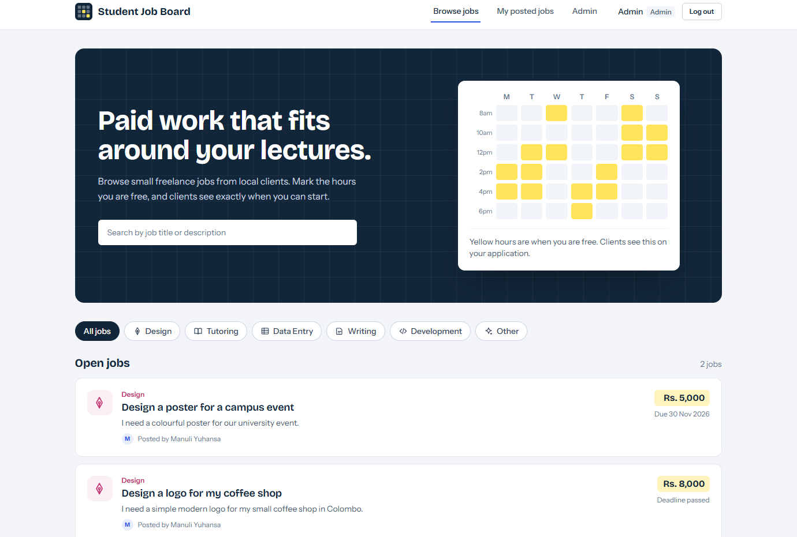
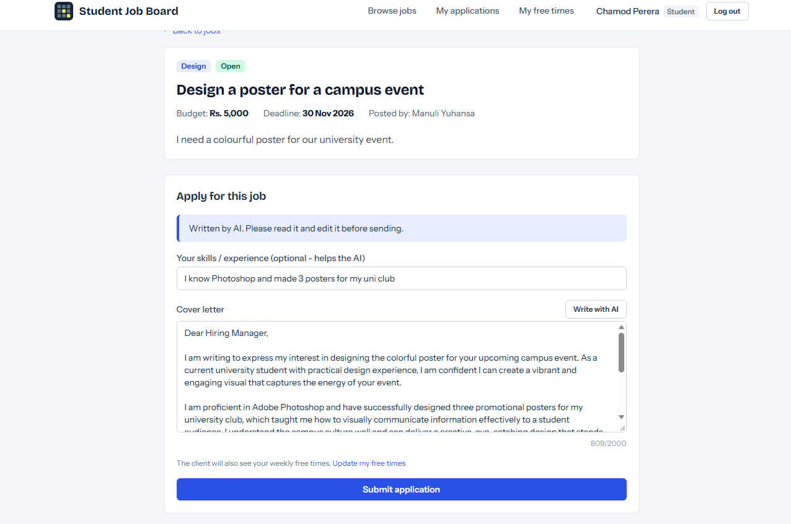
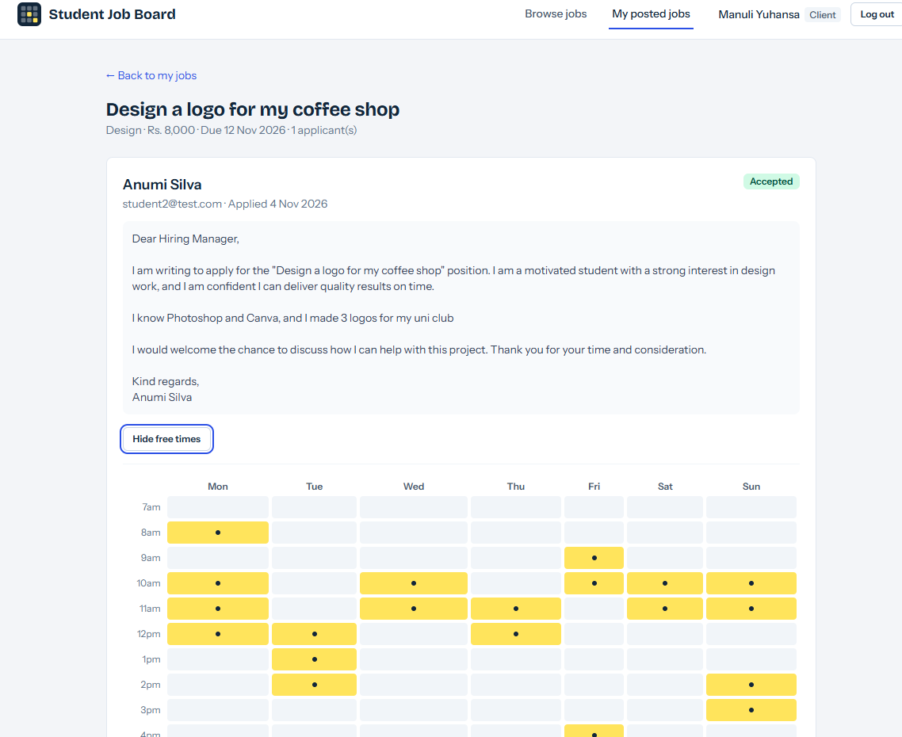

# Student Freelance Job Board - Frontend

React + TypeScript web app for the Student Freelance Job Board (ITS2020 RAD coursework).

- **Live website (frontend):** https://student-freelance-job-board-web.vercel.app
- **Live API (backend):** https://student-freelance-job-board.vercel.app
- **Backend repository:** https://github.com/yasadidias/student-freelance-job-board
- **Frontend repository:** https://github.com/yasadidias/student-freelance-job-board-web

## Features

- Public job board with search, category filter and pagination
- Register / login as **Student (USER)** or **Client (MANAGER)**; JWT access + refresh tokens with an Axios interceptor that refreshes automatically
- **Students:** apply with a cover letter, **write the cover letter with AI**, track and withdraw applications, set a **weekly free-time timetable**
- **Clients:** post / edit / close / delete jobs, review applicants (cover letter + free times), accept or reject (student gets an email)
- **Admin:** statistics, block / delete users, moderate jobs
- Role-based protected routes, responsive TailwindCSS design

## Tech stack

React 19, TypeScript, Vite, Redux Toolkit (auth, jobs, applications slices), React Router, Axios, TailwindCSS v4

## Folder structure

```
src/
  components/   Navbar, JobCard, AvailabilityGrid, ProtectedRoute, ...
  pages/        one file per page
  store/        Redux Toolkit slices + typed hooks
  services/     Axios instance (with refresh interceptor) and API functions
  types/        shared TypeScript types
  utils/        constants and formatting helpers
```

## Run locally

```bash
npm install
copy .env.example .env   # macOS/Linux: cp .env.example .env  (then set VITE_API_URL)
npm run dev              # http://localhost:5173
```

The backend must be running (see the backend repository). `npm run build` creates the production build.

## Deployment (Vercel)

1. Import this repository in Vercel (framework preset: Vite).
2. Environment variable: `VITE_API_URL` = `https://student-freelance-job-board.vercel.app/api`
3. Deploy. `vercel.json` makes page refreshes work with React Router.
4. Put the frontend URL into the backend's `CLIENT_URL` environment variable (CORS) and redeploy the backend.

Every push to the `main` branch redeploys the site automatically.

## Screenshots

### Home page and job list


### Job details and AI cover letter


### Student free-time timetable


### Client: applicants with free times


### Admin dashboard


## Author

Yasadi Dias
